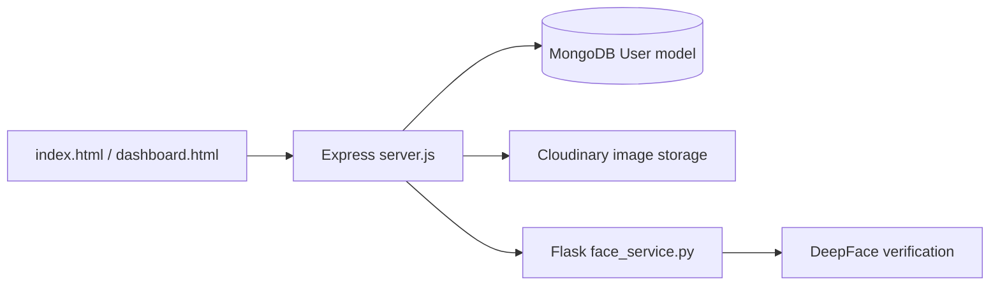

# Campus Face Recognition

## Project overview

Campus Face Recognition is a full-stack prototype for registering users with reference photographs and comparing target images against those references. It combines an Express/MongoDB application, Cloudinary image storage, browser dashboards, and a separate Flask/DeepFace comparison service.

## Problem statement

Campus workflows may need to verify whether a submitted image matches a registered person. This repository explores that flow from image upload through face comparison and dashboard presentation.

## Architecture



## Implemented features

- User registration with name, email, password, and reference photos.
- Password hashing with bcrypt.
- Multipart upload handling with Multer and in-memory buffers.
- Cloudinary integration for uploaded image URLs.
- Dashboard routes and browser pages.
- A `/compare` Flask endpoint that downloads reference/target images and calls `DeepFace.verify`.

## Technology stack

Node.js, Express, Mongoose, MongoDB, bcryptjs, Multer, Cloudinary, Axios, Flask, DeepFace, and browser HTML/CSS.

## Setup

Install the Node dependencies with `npm install`. Configure `MONGO_URI`, `CLOUDINARY_CLOUD_NAME`, `CLOUDINARY_API_KEY`, and `CLOUDINARY_API_SECRET` through environment variables. Start the Node server with the package start script.

The face service has separate Python dependencies and runs on port 7000 when executed directly:

```bash
python face_service.py
```

## Security considerations

Face images and identity data are sensitive biometric information. This prototype needs strict authorization, secure session handling, HTTPS, retention/deletion controls, request validation, and a privacy/legal review before real campus use.

## Status

Prototype. No automated test suite is declared.

## License

No license is currently declared.
